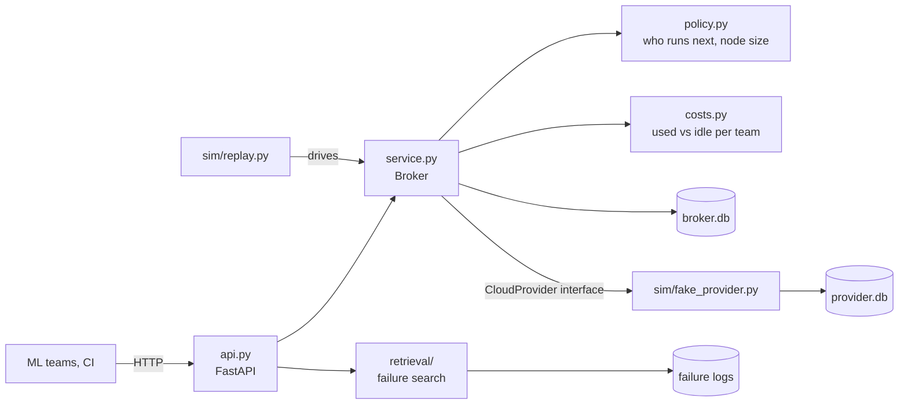
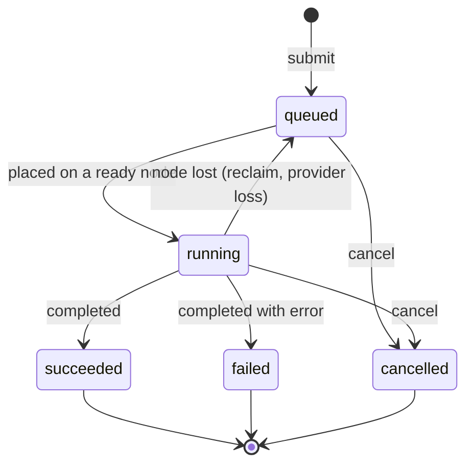
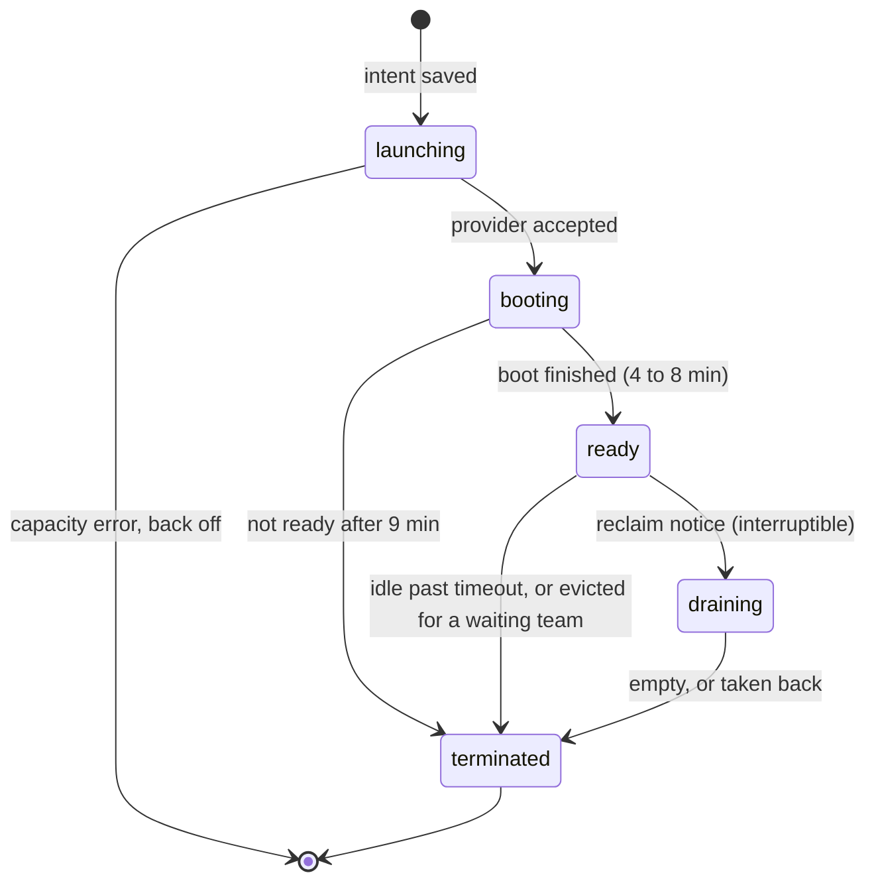

# GPU Job Broker

- A shared service that schedules ML teams' GPU jobs onto rented cloud nodes.
- Starts and stops nodes to keep the bill down, and attributes every dollar,
  idle time included, to the team that caused it.
- Includes a search over past job failures that returns the most similar
  cases and their fixes.
- Reasoning behind every design choice: [docs/DECISIONS.md](docs/DECISIONS.md).

## Requirements at a glance

| Requirement | Where it lives | Proven by |
|---|---|---|
| 1. Submit, with idempotency key | `Broker.submit`, `POST /jobs` | `test_same_idempotency_key_returns_same_job`, `test_idempotency_key` |
| 2. Scheduling that survives provider failures | `service.py`, `policy.py` | `test_capacity_outage_keeps_jobs_queued_then_recovers`, `test_stuck_boot_is_abandoned_and_replaced` |
| 3. Idle reaper | `Broker._reap_idle_nodes` | `test_idle_node_is_reaped_after_timeout` |
| 4. Job lifecycle and cancellation | `service.py` | `test_job_runs_through_full_lifecycle`, `test_cancel_queued_and_running_jobs` |
| 5. Fairness between teams | `policy.order_fair_share`, slot hand-over | `test_light_team_is_not_stuck_behind_heavy_team_burst`, `test_busy_team_gives_up_a_slot_without_preemption` |
| 6. Cost report incl. idle time | `costs.py`, `GET /reports/cost` | `tests/test_costs.py` |
| 7. Restart safety | SQLite store, `Broker._reconcile` | `test_restart_keeps_jobs_nodes_and_cost`, `test_crash_between_launch_and_record_is_reconciled` |
| 8. Trace replay and policy comparison | `sim/replay.py` | [docs/RESULTS.md](docs/RESULTS.md) |
| 9. HTTP API | `api.py` | `tests/test_api.py` |
| Retrieval track | `retrieval/` | [docs/RETRIEVAL.md](docs/RETRIEVAL.md) |

## Running it

```bash
make install     # virtualenv and dev tools
make check       # lint, type check and 84 tests, as CI does (about 10 seconds)
make serve       # API on http://127.0.0.1:8000, interactive docs at /docs
make replay      # regenerate docs/RESULTS.md (about 20 seconds)
make eval        # regenerate docs/RETRIEVAL_RESULTS.md
```

- **Without `make`:** `pip install -e ".[dev]"`, then `pytest`, `broker-serve`,
  `broker-replay` and `broker-eval-retrieval`.
- **State:** `var/broker.db` and `var/provider.db`.
- **Restarts lose nothing:** stop the server, start it with the same
  `--data-dir`, and every job, node and cost record is still there.
- **Time:** simulated time resumes where it stopped, and provider nodes keep
  billing in between, as they would in a real cloud.

## Architecture



- **Broker** (`service.py`) owns state and side effects.
- **Policy** (`policy.py`) makes the decisions as pure functions.
- **Provider** sits behind an interface with its own store, so it keeps
  billing while the broker is down.
- **Clock** jumps straight to the next due event, so a simulated week replays
  in seconds.

## Lifecycles

**Jobs**

- A job reserved on a node that is still booting stays `queued` until the node
  is ready.
- If its node disappears mid-run, the run is recorded as lost (and billed) and
  the job returns to the queue.



**Nodes**

- The launch intent is saved before the provider is called.
- That is what makes a crash mid-launch recoverable (DECISIONS.md, section 9).



## Approach in brief

- **Isolation is a hard rule.** A node belongs to one team for its whole life,
  because data outlives the job that wrote it. This also makes cost
  attribution exact.
- **Every cost has an owner.** Each team's bill is split into *used* and
  *idle*, so Finance's "who is accountable?" has an answer per team.
- **Fairness that cannot be gamed.** The next free slot goes to the team with
  the least recent GPU usage. Priority only reorders a team's own queue, so
  marking everything `high` buys nothing against other teams.
- **Failures are expected.**
  - Capacity errors back off per node type and fall back to a larger type.
  - Stuck boots are abandoned at 9 minutes.
  - Launches are idempotent, so a crash mid-launch cannot leak a billing node.
- **Simple enough for a small team to run.** No pre-emption, no in-memory
  timers, and every number in the docs comes from one command.

## Results: trace replay

- Every figure is a mean over 5 provider seeds; one seed alone can move the
  p90 wait by tens of minutes.
- Full tables: [docs/RESULTS.md](docs/RESULTS.md).

**Findings**

- **Fair share protects the teams that are not flooding the queue.**
  - On 2025-03-05 `vision` submits 163 jobs in 54 minutes.
  - `platform`'s p90 wait: 63 minutes under FIFO, 13 under fair share; its p99
    drops from 99 to 31.
  - `vision` absorbs the cost of its own burst (p90 95 → 119 minutes).
  - The trade-off: `vision` is over half of all jobs, so the *overall* p90
    rises from 85 to 103 minutes. That is the intended effect, the flood waits
    instead of everyone else, but it is a real cost to that team.
  - The total bill is unchanged within noise.
- **Most jobs start in about the boot time.**
  - Median wait: 7 minutes.
  - 64% of jobs start within the 10 minutes ML engineers asked for.
  - Every team except `vision` has a p90 of 8 to 14 minutes.
- **Idle share is 25%** of the bill, against the roughly one third Finance
  reported, and it is visible per team.
- **The burst is limited by node slots, not GPUs.**
  - Jobs trickle in and fill the 10 slots with small nodes.
  - Launching only large nodes near the cap cuts p90 from 103 to 75 minutes,
    for 12% more cost.
  - It is a setting, off by default: the team causing the burst should make
    that trade with Finance (DECISIONS.md, section 5).
- **A longer idle timeout buys nothing.** 10 to 30 minutes cost 4 to 11% more
  than 5 and make waits longer. 0 minutes is about 3% cheaper still; 5 is kept
  as a margin for quick resubmits (DECISIONS.md, section 8).
- **Interruptible nodes for `low` jobs cut about 7%** of the bill, and waits
  are no longer for it.
- **Lost runs are all interruptible reclaims.** Regular nodes are never taken
  from a running job.

## Results: failure retrieval

- `POST /failures/search` takes a question or a pasted log.
- It returns similar past failures, their fixes and a suggested fix, or an
  explicit "no match" when nothing relevant exists.

| Test set | P@3 | P@5 | Unanswerable questions correctly refused |
|---|---|---|---|
| 24 given questions (glossary written after reading them) | 1.00 | 0.99 | 6 of 6 |
| 24 own paraphrases (written first, but in view while building) | 0.96 | 0.97 | 5 of 5 |
| **24 blind questions** (written by an agent that never saw the code) | **0.94** | **0.92** | **4 of 6** |

- **Pipeline:** secret redaction → boilerplate filter learned from the corpus
  → error-aware tokens → small glossary → BM25 → ranking by shared fix.
- **Abstention:** a question is answered only if it describes a failure or
  matches a log line. On the blind set this refuses 4 of 6 off-topic questions
  (up from 2 with the first rule) at the cost of refusing 1 real failure worded
  informally. It is the weakest part and is documented as such.
- **Embeddings** were measured (in a throwaway environment, not re-runnable
  from the repo) and left out: they added nothing on this data.
- Ablation and known limits: [docs/RETRIEVAL.md](docs/RETRIEVAL.md).

## HTTP API

- Times are ISO 8601 UTC.
- Simulated time moves only through `POST /clock/advance`.

| Method | Path | Purpose |
|---|---|---|
| `POST` | `/jobs` | Submit `{team, gpus, estimated_minutes, priority}`. New jobs return `201`. With an `Idempotency-Key` header, a repeat returns the original job (`200`) and a different body under the same key is rejected (`409`). |
| `GET` | `/jobs/{id}` | One job. |
| `GET` | `/jobs?status=&team=` | Jobs, newest first. |
| `POST` | `/jobs/{id}/cancel` | Cancel a queued or running job. Repeating it is harmless; cancelling a finished job is `409`. |
| `POST` | `/jobs/{id}/complete` | Report `{outcome: succeeded \| failed}` for a running job. |
| `GET` | `/queue` | Waiting jobs, in the order the scheduler will consider them. |
| `GET` | `/nodes` | Live nodes with their jobs and GPU use. |
| `GET` | `/reports/cost?start=&end=` | GPU-hours and cost per team for a window, split into used and idle. |
| `GET` | `/clock` | Current simulated time. |
| `POST` | `/clock/advance` | `{seconds}`: process every event up to that point. |
| `POST` | `/failures/search` | `{query, k}`: similar past failures with fixes, a suggested fix and an abstain flag. |
| `GET` | `/healthz` | Liveness, plus queue depth, live nodes and launch failures. |

- **Errors:** `422` invalid input, `404` unknown job, `409` invalid state
  change or idempotency conflict.

## Code layout

```
gpu-job-broker/
├── src/broker/
│   ├── models.py              # domain types: Job, Node, Run, node prices
│   ├── config.py              # every policy setting in one place
│   ├── store.py               # SQLite document store (WAL)
│   ├── cloud.py               # CloudProvider interface and provider errors
│   ├── policy.py              # scheduling decisions as pure functions
│   ├── service.py             # Broker: job and node lifecycle, event loop, recovery
│   ├── costs.py               # GPU-hours and cost per team, used vs idle
│   ├── api.py                 # HTTP API (FastAPI)
│   ├── sim/
│   │   ├── fake_provider.py   # simulated cloud implementing CloudProvider
│   │   └── replay.py          # trace replay and policy comparison
│   └── retrieval/
│       ├── text.py            # redaction, signal lines, tokenisation
│       ├── glossary.py        # everyday words -> logged vocabulary
│       ├── index.py           # BM25, ranking by shared fix, abstention
│       └── evaluate.py        # P@k, abstention and ablation
├── tests/                     # 84 tests: provider, broker, policy, costs, API, replay, retrieval
├── data/
│   ├── 01a_trace.csv          # one week of submissions
│   ├── 01b_failure_logs.jsonl # past failures and their fixes
│   ├── 01c_retrieval_queries.jsonl
│   ├── holdout_queries.jsonl  # own paraphrases, a second development set
│   └── blind_queries.jsonl    # blind test set, written without seeing the code
├── docs/
│   ├── DECISIONS.md           # design decisions and trade-offs
│   ├── RESULTS.md             # generated by `make replay`
│   ├── RETRIEVAL.md           # retrieval design, ablation, limits
│   └── RETRIEVAL_RESULTS.md   # generated by `make eval`
├── .github/workflows/ci.yml   # lint, types, tests, replay, eval on Python 3.10 and 3.12
├── Makefile
└── pyproject.toml
```

- **Policy and mechanism are kept apart.** Changing *who runs next* or *how
  big a node to launch* is an edit to `policy.py`, testable without the event
  loop.
- **The simulator is swappable.** A real cloud plugs in by implementing
  `cloud.CloudProvider`; the broker never imports the simulator.

## Trade-offs and next steps

- **No pre-emption.** It would shorten burst waits further, but killing jobs
  without a checkpoint contract wastes paid GPU time and causes surprising
  failures (DECISIONS.md, section 3).
- **No budgets or hard quotas yet.** Fair share and visible idle cost come
  first; budgets need a policy agreed with Finance.
- **Jobs that never report completion.** A job submitted through the API runs
  until a client calls `complete`, so a forgotten job keeps its node billing.
  Next step: a heartbeat lease that fails the job when the client goes quiet.
  A hard limit on runtime would be wrong here: real jobs in the trace run up to
  12 times their estimate.
- **Identity.** `team` is taken from the request. In production it must come
  from the caller's credentials, or one team could bill another.
- **Warm pool.** On this trace a longer idle timeout does not help; a pool
  sized from arrival history might, given more than one week of data.
- **Metrics and alerts** on queue depth, launch failure rate and idle share, so
  the platform team hears about problems before users do.
- **Retrieval:** grow the glossary from incident tickets, and cluster fixes
  that are worded differently but mean the same thing.

## Use of AI tools

- **Tool:** Claude Code (Anthropic), used as a pair programmer throughout.
- **What it did:** profiled the trace and failure logs, drafted the design
  notes, modules and tests, and ran the replay and retrieval experiments.
- **What I did:** set the direction and the quality bar and reviewed the work
  as it went in. That included:
  - cutting the design notes back to what each decision needs;
  - replacing magic values in tests with readable ones;
  - requiring each trade-off (node sizing, idle timeout, embeddings,
    abstention) to be settled by a measured comparison rather than intuition.
- **Independent review:** I had a separate AI reviewer, given only the brief
  and the repo, critique the submission. It found two real problems, both
  fixed and documented:
  - an eviction bug that quietly killed jobs a node had just received;
  - an evaluation claim ("held-out, never tuned on") that the repo did not
    support. It was replaced by a blind test set written by another agent that
    never saw the code.
- **Reproducible:** every measurement re-runs with `make replay` and
  `make eval`.

## Time

- **When:** one evening, 2026-11-25.
- **Before the first commit:** reading the brief, vetting the files and
  planning (the first commit is 19:53 IST).
- **Build:** 19:53 to 21:00 IST.
- **Review and fixes:** 21:00 to 22:31 IST, after two independent reviews.
- **Total:** about 3 hours, including time with AI tools.
- **Commits that share a timestamp** were made together after I had reviewed
  them as a pair; they are separate steps, not a squash.
