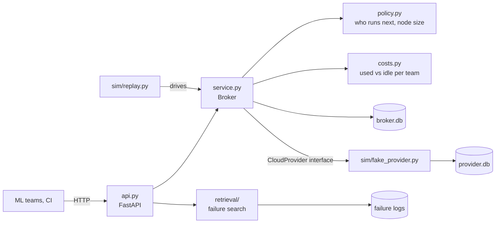
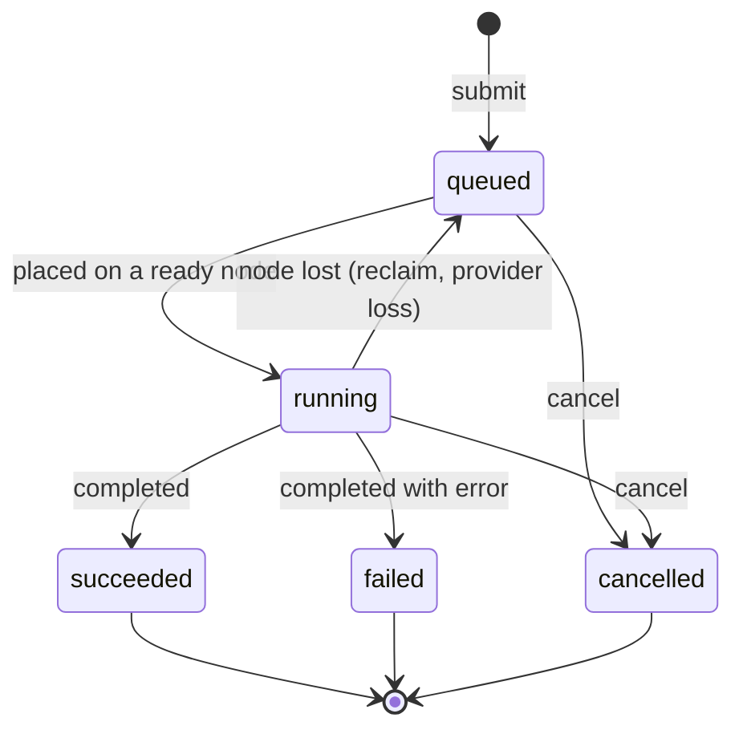
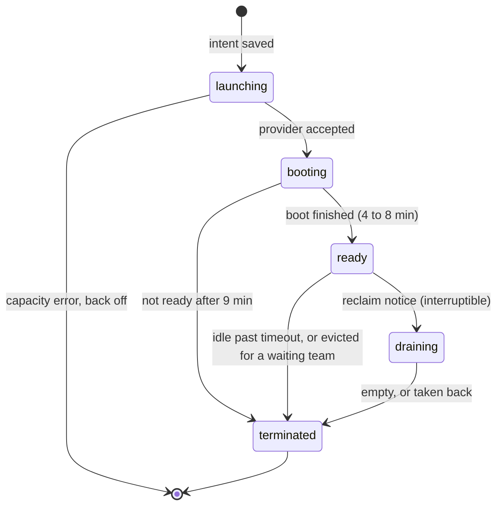

# Job Broker

A shared service that schedules ML teams' GPU jobs onto rented cloud nodes,
starts and stops those nodes to keep the bill under control, and attributes
every dollar, idle time included, to the team that caused it. A second
component searches past job failures for the most similar cases and their fixes.

The reasoning behind each design choice is in [docs/DECISIONS.md](docs/DECISIONS.md).

## Requirements at a glance

| Requirement | Where it lives | Proven by |
|---|---|---|
| 1. Submit, with idempotency key | `Broker.submit`, `POST /jobs` | `test_same_idempotency_key_returns_same_job`, `test_idempotency_key` |
| 2. Scheduling that survives provider failures | `service.py`, `policy.py` | `test_capacity_outage_keeps_jobs_queued_then_recovers`, `test_stuck_boot_is_abandoned_and_replaced` |
| 3. Idle reaper | `Broker._reap_idle_nodes` | `test_idle_node_is_reaped_after_timeout` |
| 4. Job lifecycle and cancellation | `service.py` | `test_job_runs_through_full_lifecycle`, `test_cancel_queued_and_running_jobs` |
| 5. Fairness between teams | `policy.order_fair_share`, slot hand-over | `test_light_team_is_not_stuck_behind_heavy_team_burst`, `test_busy_team_gives_up_a_slot_without_preemption` |
| 6. Cost report incl. idle time | `costs.py`, `GET /reports/cost` | `tests/test_costs.py` |
| 7. Restart safety | SQLite store, `Broker._reconcile` | `test_restart_keeps_jobs_nodes_and_cost`, `test_crash_between_launch_and_record_is_reconciled` |
| 8. Trace replay and policy comparison | `sim/replay.py` | [docs/RESULTS.md](docs/RESULTS.md) |
| 9. HTTP API | `api.py` | `tests/test_api.py` |
| Retrieval track | `retrieval/` | [docs/RETRIEVAL.md](docs/RETRIEVAL.md) |

## Running it

```bash
make install     # virtualenv and dev tools
make check       # lint, type check and 75 tests, as CI does (about 10 seconds)
make serve       # API on http://127.0.0.1:8000, interactive docs at /docs
make replay      # regenerate docs/RESULTS.md (about 20 seconds)
make eval        # regenerate docs/RETRIEVAL_RESULTS.md
```

Without `make`: `pip install -e ".[dev]"`, then `pytest`, `broker-serve`,
`broker-replay` and `broker-eval-retrieval`.

State lives in `var/broker.db` and `var/provider.db`. Kill the server, start it
again with the same `--data-dir`, and every job, node and cost record is still
there. Simulated time resumes where it stopped, and provider nodes keep billing
in between, as they would in a real cloud.

## Architecture



The broker owns state and side effects; `policy.py` makes the decisions as
pure functions. The provider sits behind an interface and keeps its own
store, as a real cloud would, so it keeps billing while the broker is down.
Time moves only by jumping to the next due event, so a simulated week
replays in seconds.

## Approach in brief

- **Isolation is a hard rule.** A node belongs to one team for its whole life,
  because data outlives the job that wrote it. This also makes cost
  attribution exact.
- **Every cost has an owner.** Each team's bill is split into *used* and
  *idle*, so Finance's question "who is accountable?" has an answer per team.
- **Fairness without gaming.** The next free slot goes to the team with the
  least recent GPU usage. Priority only reorders a team's own queue, so marking
  everything `high` buys nothing against other teams.
- **Failures are expected.** Capacity errors back off per node type and fall
  back to a larger type. Stuck boots are abandoned at 9 minutes. Launches are
  idempotent, so a crash mid-launch cannot leak a billing node.
- **Simple enough to run with a small team.** No pre-emption, no in-memory
  timers, and every number in the docs is reproducible with one command.

## Lifecycles

**Jobs.** A job reserved on a node that is still booting stays `queued` until
the node is ready. If its node disappears mid-run, the run is recorded as lost
(and billed), and the job goes back to the queue.



**Nodes.** The launch intent is saved before the provider is called, which is
what makes a crash mid-launch recoverable (DECISIONS.md, section 9).



## Results: trace replay

Each figure is a mean over 5 provider seeds; a single seed moves the p90 wait
by up to 40 minutes. Full tables: [docs/RESULTS.md](docs/RESULTS.md).

- **Fair share protects the teams that are not flooding the queue.** On
  2025-03-05 `vision` submits 167 jobs in under 3 hours. Under FIFO,
  `platform`'s p90 wait is 59 minutes; under fair share it is 13. `vision`
  absorbs the cost of its own burst (p90 87 → 100 minutes), and the total bill
  is unchanged within noise.
- **Most jobs start in roughly the boot time.** The median wait is 7 minutes
  and 65% of jobs start within the 10 minutes ML engineers asked for. Every
  team except `vision` has a p90 of 8 to 15 minutes.
- **Idle share is 26%** of the bill, against the roughly one third Finance
  reported, and it is visible per team.
- **The burst is limited by node slots, not GPUs.** Jobs trickle in and fill
  the 10 slots with small nodes. Launching only large nodes near the cap cuts
  the p90 from 86 to 71 minutes for 11% more cost. It is a setting, off by
  default, because the team causing the burst should make that trade with
  Finance (DECISIONS.md, section 5).
- **A longer idle timeout buys nothing.** 20 to 30 minutes adds about 10% to the
  bill with no shorter waits, so the default is 5 minutes.
- **Interruptible nodes for `low` jobs cut about 7%** of the bill with no
  measurable effect on waits.

## Results: failure retrieval

`POST /failures/search` accepts a question or a pasted log and returns similar
past failures, their fixes, a suggested fix, and an explicit "no match" when
nothing relevant exists.

| Test set | P@3 | P@5 | Unanswerable questions correctly refused |
|---|---|---|---|
| 24 given questions | 1.00 | 0.99 | 6 of 6 |
| 24 held-out paraphrases, written before the pipeline and never tuned on | 0.97 | 0.97 | 5 of 5 |

The pipeline is lexical: secret redaction, a boilerplate filter learned from
the corpus, error-aware tokens, a small glossary, BM25, and ranking by shared
fix. An embedding model was measured and left out because it added nothing on
this data. The ablation and the known limits are in
[docs/RETRIEVAL.md](docs/RETRIEVAL.md).

## HTTP API

Times are ISO 8601 UTC. Simulated time moves only through `POST /clock/advance`.

| Method | Path | Purpose |
|---|---|---|
| `POST` | `/jobs` | Submit `{team, gpus, estimated_minutes, priority}`. With an `Idempotency-Key` header, a repeat returns the original job (`200`) and a different body under the same key is rejected (`409`). New jobs return `201`. |
| `GET` | `/jobs/{id}` | One job. |
| `GET` | `/jobs?status=&team=` | Jobs, newest first. |
| `POST` | `/jobs/{id}/cancel` | Cancel a queued or running job. Repeating it is harmless; cancelling a finished job is `409`. |
| `POST` | `/jobs/{id}/complete` | Report `{outcome: succeeded \| failed}` for a running job. |
| `GET` | `/queue` | Waiting jobs, in the order the scheduler will consider them. |
| `GET` | `/nodes` | Live nodes with their jobs and GPU use. |
| `GET` | `/reports/cost?start=&end=` | GPU-hours and cost per team for a window, split into used and idle. |
| `GET` | `/clock` | Current simulated time. |
| `POST` | `/clock/advance` | `{seconds}`: process every event up to that point. |
| `POST` | `/failures/search` | `{query, k}`: similar past failures with fixes, a suggested fix and an abstain flag. |
| `GET` | `/healthz` | Liveness, plus queue depth, live nodes and launch failures. |

Errors: `422` invalid input, `404` unknown job, `409` invalid state change or
idempotency conflict.

## Code layout

```
src/broker/
  models.py  config.py  store.py    domain types, settings, SQLite persistence
  cloud.py                          CloudProvider interface the broker depends on
  policy.py                         scheduling decisions as pure functions
  service.py                        Broker: job and node lifecycle, event loop, recovery
  costs.py                          GPU-hours and cost per team, used vs idle
  api.py                            HTTP API
  sim/        fake_provider.py      simulated cloud implementing CloudProvider
              replay.py             trace replay and policy comparison
  retrieval/  text.py               redaction, signal lines, tokenisation
              glossary.py           everyday words -> logged vocabulary
              index.py              BM25, ranking by shared fix, abstention
              evaluate.py           P@k, abstention and ablation
docs/         DECISIONS.md  RESULTS.md  RETRIEVAL.md  RETRIEVAL_RESULTS.md
```

Policy and mechanism are kept apart: changing *who runs next* or *how big a
node to launch* is an edit to `policy.py`, testable without the event loop. A
real cloud plugs in by implementing `cloud.CloudProvider`; the broker never
imports the simulator. CI runs lint, type checks, tests, the replay and the
retrieval evaluation on Python 3.10 and 3.12, and `make docker` builds a
non-root image with a health check and a state volume.

## Trade-offs and next steps

- **No pre-emption.** It would shorten burst waits further, but killing jobs
  without a checkpoint contract wastes paid GPU time and produces surprising
  failures (DECISIONS.md, section 3).
- **No budgets or hard quotas yet.** Fair share and visible idle cost come
  first; budgets need a policy agreed with Finance.
- **Identity.** `team` is taken from the request. In production it must come
  from the caller's credentials, or one team could bill another.
- **Warm pool.** On this trace a longer idle timeout does not help; a pool sized
  from arrival history might, given more than one week of data to tune on.
- **Metrics and alerts** on queue depth, launch failure rate and idle share, so
  the platform team hears about problems before users do.
- **Retrieval:** grow the glossary from incident tickets, and cluster fixes
  that are worded differently but mean the same thing.

## Use of AI tools

I worked with Claude Code (Anthropic) as a pair programmer. It handled the
mechanical parts: profiling the trace and the failure logs, drafting modules
and tests against the design in DECISIONS.md, and running the replay and
retrieval experiments. I owned the direction and reviewed every change before
it was committed. In practice that meant cutting the design notes back to what
each decision needs, replacing magic values in tests with readable ones, and
insisting that each trade-off (node sizing, idle timeout, embeddings) be
settled by a measured comparison rather than by intuition. Those measurements
are reproducible with `make replay` and `make eval`.

## Time

One sitting on 2026-11-25, about 1.5 hours including design and review (first
commit 19:53 IST, finished 21:00 IST).
