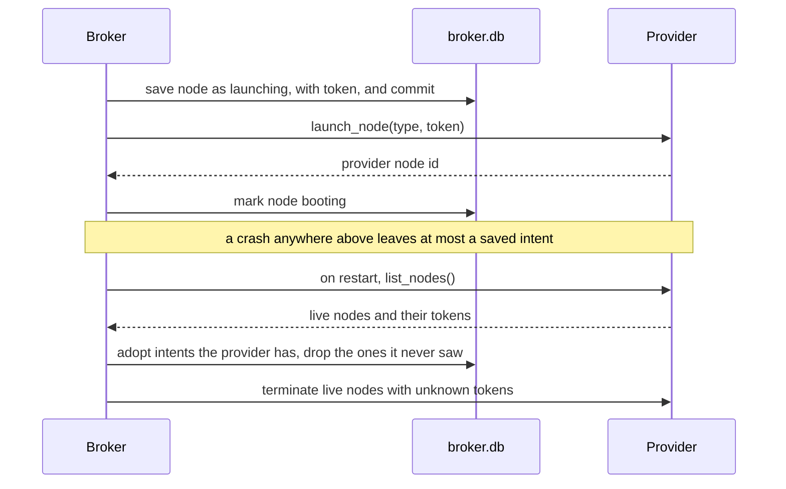

# Design decisions

Each decision lists what it costs, not only what it buys. Where the brief
was open, the assumption is written down here so it can be challenged.

## 0. How I weighed the stakeholders

| Voice | Weight | Why |
|---|---|---|
| Security: no two teams on one machine at once | **Hard constraint** | A data-isolation breach is not recoverable; slower jobs and a higher bill are. |
| Platform team: not paged every week | **Hard constraint on design** | A small team owns this. Every mechanism must be simple, deterministic and self-healing. No clever optimiser that nobody can debug at 3 a.m. |
| Finance: bill doubled, a third was idle | **Primary objective** | Idle time is the measurable waste, and accountability needs every dollar attributed to a team. |
| ML engineers: start within 10 minutes | **Target, not a guarantee** | A cold node takes 4 to 8 minutes to boot, so a 10-minute start is achievable when capacity exists. It cannot be guaranteed during provider outages or under the 10-node cap, and promising it would mean paying for idle warm nodes, which is the thing Finance is complaining about. |

The rest of the design follows from that ordering.

## 1. Isolation: one team per node for the node's whole life

A node is bound to a single team at launch and is never reused for another
team, even after it is empty.

- *Why lifetime, not just "at the same time":* the brief says a team's data
  must never sit on a machine at the same time as another team's job. Data
  outlives the job (local scratch, page cache, container layers). Without a
  verified wipe primitive from the provider, the only safe rule is that a node
  never changes owner.
- *Cost:* less packing. Two teams with one 1-GPU job each need two nodes
  instead of sharing one. On this trace the effect is small, because
  `gpu-s` (1 GPU) costs the same per GPU as the large nodes.
- *Bonus:* cost attribution becomes exact. Every second of every node,
  including idle and boot time, belongs to exactly one team.

## 2. Cost attribution: the owning team pays for everything, broken down

Every node second is charged to the team that owns the node. The report
splits each team's cost into:

- **used**: GPU-seconds actually occupied by that team's running jobs.
- **idle**: everything else, meaning boot time, empty nodes waiting for the
  reaper, unused GPUs on a partly full node, failed launches, and the
  10-minute minimum-billing top-up.

Why charge idle to the team and not to a shared "platform overhead" bucket:
Finance asked *who is accountable*. A shared bucket is accountable to nobody.
Because nodes are dedicated (decision 1), the idle time on a team's node was
caused by that team's demand, so the attribution is causal, not arbitrary.
Showing idle separately keeps it honest: a team can see that, for example,
30% of its bill is idle and argue for a different reaper timeout.

GPU-hours follow the brief exactly: GPUs requested × hours the job ran.

## 3. Priority: ordering inside a team, not a global queue jump

- `high` jumps ahead of the team's own `normal` and `low` jobs.
- Between teams, **fair share decides** (decision 4). Priority does not let
  one team overtake another.
- `high` never pre-empts a running job.

Why: in the trace, `nlp` marks 60 of its 85 jobs `high`. If `high` were a
global queue-jump, every team would learn to mark everything `high` and
priority would mean nothing. Scoping priority to the team removes the
incentive to game it: marking everything `high` gains a team nothing against
other teams.

Why no pre-emption: killing a job wastes the GPU time already spent (there
is no checkpoint contract with users), it creates surprising failures that
become support tickets, and it adds a hard-to-test code path. That fails the
platform team's constraint. It can be added later behind a checkpoint-aware
flag.

**Aging:** a `low` job that has waited 60 minutes is treated as `normal`, so
nothing starves forever inside a team.

## 4. Fairness: decayed fair share across teams

The next scarce resource (a node slot, under the 10-node cap) goes to the
team that has used the **least GPU time recently**. "Recently" is an
exponentially decayed sum with a 4-hour half-life.

- *Why usage-based and not round-robin:* round-robin per job rewards teams
  that submit many small jobs. Usage-based fair share is the standard
  approach (Slurm fair-share, YARN fair scheduler, Kubernetes Kueue) and is
  easy to explain: "you used the most lately, so you go last."
- *Why decayed:* without decay, a team that ran a big job on Monday is
  penalised all week. A 4-hour half-life forgives yesterday and still
  restrains a team that is currently flooding the queue.
- *Node-slot share:* while another team is blocked by the cap, a team cannot
  launch a node beyond its share of the 10 slots (10 divided by the number of
  teams with work). With no contention, any team may use all 10.
- *Free slots first:* when the cap blocks a waiting team, idle nodes of any
  team are terminated immediately instead of waiting for the idle timeout.
- *Hand over a slot without pre-emption:* a busy team keeps refilling its own
  nodes, so none ever empties and a blocked team would wait for the whole
  backlog. When a team under its share is blocked, the over-share team's node
  expected to free up soonest stops receiving new jobs; once its running jobs
  finish, the slot goes to the waiting team.

The trace is a real test of this: on 2025-03-05 `vision` submits 163 jobs in
54 minutes (06:04 to 06:58 UTC). Under FIFO everyone else waits behind that
burst. The replay compares the two policies.

## 5. Placement and node sizing

- **Best fit:** put a job on the team's node with the least free GPUs that
  still fits. This keeps other nodes empty so the reaper can stop them.
- **Booting nodes count as capacity.** A job can be reserved on a node that
  is still starting. Jobs arrive one at a time, so while a team already has
  nodes booting the next node is sized to cover them too: eight 1-GPU jobs
  in a row launch 1-, 4- and 8-GPU nodes (3 slots), not eight nodes.
- **Size by demand:** when a launch is needed, pick the smallest node type
  that covers the team's unplaced demand, capped at 8 GPUs. One 1-GPU job
  gets a `gpu-s`; a backlog of six 1-GPU jobs gets a `gpu-l`. Per GPU,
  `gpu-s` costs 1.00/h, `gpu-m` 1.125/h and `gpu-l` 1.0625/h, so packing a
  backlog onto one node costs almost nothing extra and saves node slots,
  which are the real constraint under the 10-node cap.
- **Not done by default: large nodes under slot pressure.** In the replay,
  `vision`'s burst arrives at about three jobs a minute and fills the 10
  slots with small nodes (about 55 of 80 possible GPUs). Launching only
  `gpu-l` once 8 of 10 slots are used cuts p90 wait from 103 to 75 minutes but
  raises the weekly bill by 12% and idle share to 34% (docs/RESULTS.md). The wait falls on
  the team causing the burst while fair share protects everyone else, so I
  leave it as an opt-in setting (`slot_pressure_fraction`) for that team and
  Finance to decide on, rather than a default everyone pays for.

## 6. Provider failures

- **Capacity errors come in bursts**, so retrying immediately is wasteful.
  Each (node type, interruptible) pair gets an exponential back-off
  (1, 2, 4 … up to 30 minutes), and the broker tries the next larger node type
  while the preferred one is backing off.
- **Boot timeout hedging:** the provider says a node is ready within 8
  minutes or reports failure at 15. If a node is not ready after 9 minutes the
  broker terminates it and launches a replacement. Cost: 10 minutes of billing
  (the minimum) instead of 15, and jobs wait 6 minutes less.
- **Idempotent launches:** the broker records the launch intent with a client
  token *before* calling the provider, and the provider deduplicates on that
  token. A crash between "provider launched" and "broker recorded" therefore
  cannot leak an unbilled-but-unknown node (see decision 9).
- If the provider is down entirely, submissions, cancellations and reports
  keep working; jobs simply stay queued.

## 7. Interruptible nodes

- Used only for jobs whose effective priority is `low`. Users who mark a job
  `low` have said they can tolerate delay; a reclaim is a delay.
- Regular jobs never run on interruptible nodes. `low` jobs may still fill
  free GPUs on regular nodes the team already pays for.
- On the 2-minute notice the node stops accepting work. When it is taken
  back, its jobs return to the queue, are promoted to `normal`, and are pinned
  to regular capacity so that the same job is not lost twice. Without a
  checkpoint contract the run restarts from zero; the lost time is still
  billed to the team.
- Simulation model: reclaims arrive as a Poisson process at 0.05 per
  node-hour, which matches "about 5% of node-hours".

Trade-off: 65% cheaper per hour against restarted work. The replay reports
both numbers so the choice can be revisited with data.

## 8. Idle reaper

- A node with no running or reserved jobs for more than `idle_timeout`
  (default 5 minutes, configurable) is terminated.
- **Never before the 10-minute billing minimum:** an idle node younger than
  10 minutes is already paid for, so it stays warm until then for free.
- Draining interruptible nodes and nodes still booting are not reaped (the
  boot timeout handles stuck nodes).

The default comes from the replay sweep (docs/RESULTS.md):

- 10, 20 and 30 minutes cost 4 to 11% more than 5 and make waits longer, not
  shorter: arrivals are bursty with long gaps, so a warm node is rarely reused
  in time, and under the node cap an idle node holds a slot another team needs.
- 0 minutes (reap as soon as the paid 10-minute minimum is used) is about 3%
  cheaper than 5 on this trace, with waits the same within seed noise.
- I keep 5 minutes as a margin for a pattern one week of synthetic data does
  not contain: users resubmitting a failed job within minutes, which would pay
  a full cold start at 0. With more real traffic, 0 is the first thing I would
  test.

## 9. Restart safety

- **SQLite (WAL mode) is the source of truth** for jobs, nodes, job runs,
  idempotency keys and the simulated clock. Each API call and each processed
  simulation event commits in one transaction.
- **The fake provider keeps its own separate store,** because in reality it
  is an external system. Its nodes keep billing while the broker is down.
- **Reconciliation on startup:** the broker compares its records against
  `provider.list_nodes()`.
  - A provider node with a token the broker recorded but never confirmed is
    adopted.
  - A node the broker has no record of is terminated (an orphan only costs
    money).
  - A node the broker thinks is alive but the provider has lost is marked
    gone, and its jobs return to the queue.
- **Simulated time resumes where it stopped.** Events that fell due while
  the broker was down are processed in order on the next clock advance.
- **Launch and recovery, end to end:**

- **No in-memory timers.** The next event time is always computed from
  persisted timestamps, so there is no timer heap to lose.

## 10. Data quality decisions (trace)

| Issue | Rows | Decision |
|---|---|---|
| Rows not sorted by time | many | Sort by `submitted_at`; ties keep file order. |
| Timestamps with an offset (`+01:00`, `-07:00`) instead of `Z` | 15 | Parsed as written and normalised to UTC before sorting and deduplication. |
| `gpus = 3` | 1 | **Rejected**, as the API would reject it (the brief allows 1, 2, 4, 8). Silently rounding up to 4 would bill the team for a GPU it did not ask for. |
| `gpus = 16` | 1 | **Rejected**: it cannot fit on any node. |
| Same submission twice (every field equal once the time is normalised to UTC) | 14 pairs, one written in two time zones (lines 351 and 352) | Treated as **client retries** of one submission and deduplicated through the idempotency key (hash of the parsed row, so `18:01Z` and `19:01+01:00` match). Two genuinely separate jobs matching on runtime and outcome to the minute is unlikely. Replay prints the count either way and `--keep-duplicates` turns it off. |
| Same team, same second, different fields | 31 groups | Kept: these are different jobs submitted together (for example a sweep). |
| `actual_minutes` far above estimate (up to 2,880 vs 240) | some | Kept. The scheduler only sees the estimate, as the brief requires. |

## 11. Simulation clock

Discrete-event, not fixed-step: the broker jumps straight to the next due
event (job end, node ready, reclaim, reaper deadline, back-off expiry,
aging). A week replays in seconds and timestamps stay exact to the second,
which matters for per-second billing.

## 12. What I deliberately did not build

- Pre-emption of running jobs (decision 3).
- Per-team budgets and hard quotas. Fair share plus visible idle cost is the
  first step; budgets need a policy conversation with Finance.
- Multi-node jobs. The brief says one job runs on one node.
- Authentication on the API. The `team` field is trusted. In production it
  would come from the caller's identity, not from the request body, otherwise
  any team could bill another.
