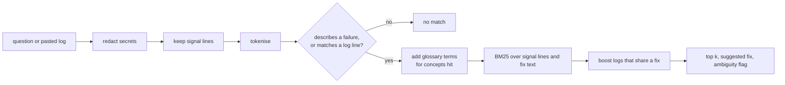

# Retrieval: similar past failures

`POST /failures/search {query, k}` takes a free-text question or a failed
job's log and returns the most similar past failures, their fixes, a
suggested fix, and whether it abstained. Code: `src/broker/retrieval/`.
Full per-question results: [RETRIEVAL_RESULTS.md](RETRIEVAL_RESULTS.md)
(`broker-eval-retrieval` regenerates it).

## What the data asks for

- **Relevance means the same cause, not the same words.** `jwt expired while
  calling /v1/models` and `401 Unauthorized: token expired` share almost no
  tokens but have one cause.
- **Most of each log is noise.** Heartbeats, epoch counters and deprecation
  warnings appear in 20 to 37 of the 59 logs; the error is one line.
- **Everyday words for technical terms:** "disk is full" vs `No space left on
  device`, "blew up" vs `Gradient norm inf`.
- **Logs contain secrets** (`Authorization: Bearer …`, `SERVICE_PASSWORD=…`).
- **Six of the 24 questions have no answer** and should get none.
- **Traps:** three OOM logs have no recorded fix but are relevant; F900 and
  F901 are the same log with two different fixes.

## Pipeline and what each step buys

P@3 / P@5 per test set (the sets are explained under "How honest are these
numbers" below):

| Step | Given | Own held-out | Blind | Log→log P@5 |
|---|---|---|---|---|
| BM25 on the raw log | 0.67 / 0.57 | 0.61 / 0.52 | 0.63 / 0.56 | 0.48 |
| + keep signal lines only | 0.67 / 0.62 | 0.67 / 0.57 | 0.57 / 0.54 | 0.74 |
| + index the resolution text | 0.81 / 0.80 | 0.65 / 0.58 | 0.74 / 0.67 | 0.80 |
| + glossary query expansion | 0.98 / 0.93 | 0.95 / 0.89 | 0.98 / 0.93 | 0.90 |
| + rank by shared fix | 1.00 / 0.99 | 0.96 / 0.97 | 1.00 / 0.98 | 1.00 |
| + abstain unless a glossary concept is hit (v1) | 1.00 / 0.99 | 0.96 / 0.97 | 1.00 / 0.98 | 1.00 |
| + abstain unless the question describes a failure (final) | 1.00 / 0.99 | 0.96 / 0.97 | 0.94 / 0.92 | 1.00 |

Unanswerable questions correctly refused:

| Rule | Given | Own held-out | Blind |
|---|---|---|---|
| v1: any glossary concept counts as on-topic | 6 of 6 | 5 of 5 | 2 of 6 at first scoring (3 of 6 after the log-lines-only literal check) |
| Final: the question must describe a failure | 6 of 6 | 5 of 5 | **4 of 6**, and 1 real failure wrongly refused |

How the final rule was kept honest:

- The blind set and its v1 score were committed first.
- The rule was designed on the given set, my own held-out set and an
  independent reviewer's questions, then frozen.
- The blind set was scored once, and the result above is reported as it came
  out, including what got worse.

1. **Redact first.** Secrets are masked before indexing, so they can never be
   returned or leak into an index.
2. **Signal lines, learned from the corpus.** A line whose template (digits
   masked) appears in more than 15% of logs is boilerplate; DEBUG lines are
   dropped. Nothing is hand-listed, so the same filter cleans a pasted log.
3. **Error-aware tokens.** Split `PermissionError` and `OOMKilled` (not
   `NaN`), keep short codes such as 137 and 401, drop step counts and shard
   ids, light stemming.
4. **Glossary expansion.** Nine failure concepts map the words people use to
   the words failures are logged in. Expansion terms weigh 0.4 so they help
   recall without outvoting what the user typed. This step is the largest
   single gain.
5. **Rank by shared fix.** Each log is boosted by the best score among logs
   that share its recorded fix. One strong match then lifts the same-cause
   logs that are worded differently. Logs without a fix stand alone, so the
   no-fix OOM logs are still found on their own text.
6. **Abstain.** A question is answered only if it *describes a failure*
   (general failure words such as `failed`, `died`, `expired`, phrases such as
   "ran out" or "can't", or a status code such as 137 or 401), or if it
   literally matches a log line, which covers pasted logs. Topic words alone,
   such as `memory` or `token`, are not enough: "how much memory does a node
   have" gets no match. A wrong fix sent with confidence costs more than "no
   match".

The response also carries a **suggested fix**: a score-weighted vote over the
top matches, skipping logs with no fix, so a query that lands on F911 still
gets the OOM fix. It is flagged **ambiguous** when two top matches have
near-identical logs but different fixes (F900 and F901), instead of picking one
silently.

## How honest are these numbers

- **Given (01c): optimistic.** The glossary was written after reading these
  24 questions.
- **Own held-out: not independent.** I wrote these 24 paraphrases
  (`data/holdout_queries.jsonl`) before the pipeline and never scored
  decisions on them, but I wrote the glossary afterwards with them in view;
  several glossary words (`vram`, `spot`, `preempted`, `session`) appear only
  there. Treat it as a second development set.
- **Blind: the honest estimate.** 24 questions (`data/blind_queries.jsonl`)
  written by a separate agent that saw only the brief and the 59 logs, never
  the code, glossary or other questions. It was committed, and its first score
  recorded, before any further change to the pipeline.
- **Log→log** uses every log as the query, excluding itself; relevant means
  the other logs of the same cause.

## Embeddings: measured, not shipped

A local embedding model (`bge-small-en-v1.5` via `fastembed`) scored
0.85 / 0.79 alone on the given questions. Merged with the lexical ranking by
reciprocal rank fusion
([Cormack et al., 2009](https://plg.uwaterloo.ca/~gvcormac/cormacksigir09-rrf.pdf)),
it matched the lexical pipeline on the held-out set and was slightly worse on
the given set (P@5 0.96 vs 0.99). Its similarity scores also overlap for
answerable and unanswerable questions (0.65 vs 0.66), so it does not help
abstention. Failures here are identified by exact error strings, which is
lexical retrieval's strength. Embeddings would add about 200 MB of
dependencies and a model download for no measured gain, so they are left out.
This comparison ran in a separate throwaway environment, before the blind set
existed; the script is not part of the repo, so these figures cannot be
re-run from it.

## Limits and next steps

- **Abstention is the main risk on unseen questions.** On the blind set:
  - a failure described in informal words ("my spot machine got **yanked**")
    is refused, because the failure-word list lacks them;
  - a how-to question that shares a phrase with a log ("generate a personal
    **access token**") passes the literal-match check;
  - one word can mean two things ("early **stopping**" vs "heartbeats
    stopped").
  Next step: replace the word lists with a small classifier for "is this a
  failure report?", trained on real support questions, and revisit embeddings
  once there is enough data to show they help.
- **"Same fix" is an exact string match.** Real tickets word one fix many ways;
  fixes would need clustering first.
- **59 logs.** BM25 over an in-memory index is right at this size. At thousands
  of logs the same pipeline fits a search engine with these steps as analysers.
